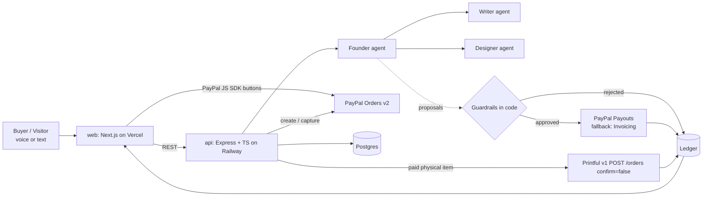

# HollowCo — a company with nobody in it

Speak a business idea. In about a minute an **AI founder agent** creates a brand (name, tagline, colours, logo) and opens a shop. An **AI writer agent** writes e-books (delivered instantly as PDF/Markdown after payment). An **AI designer agent** makes print-on-demand designs (shirts, mugs) — paid orders become **Printful draft orders** (never confirmed). Buyers pay with **PayPal** (JS SDK + Orders v2). After fulfilment the founder pays its staff agents with **PayPal Payouts**. Every cent lands on a **live public P&L ledger** (AG Grid).

**AI proposes, code disposes.** Prices and payouts are only *proposals*; `api/src/guardrails.ts` enforces hard limits (price $1–$60, max $5 per task, ≤30% of order revenue, $50/day cap, allowlisted recipients, USD only). Rejected proposals are logged to the ledger. Try the *"jailbreak the founder"* box on the ledger page — it always fails, visibly.

- Live demo: https://hollowco.vercel.app · API: https://api-production-692d8.up.railway.app/health
- Watches: coming soon.

## Architecture



## Setup

```bash
# root .env.local (never committed)
PAYPAL_CLIENT_ID=... PAYPAL_CLIENT_SECRET=... PAYPAL_ENV=sandbox
# optional: OPENAI_API_KEY or XAI_API_KEY (else deterministic mock AI), PRINTFUL_API_TOKEN (+ PRINTFUL_STORE_ID), DATABASE_URL (else in-memory)
cd api && npm i && npm run dev        # :4000
npm test                              # sandbox e2e: shop -> order -> capture path -> fulfil -> payouts -> ledger -> jailbreak
cd ../web && npm i && NEXT_PUBLIC_API_URL=http://localhost:4000 npm run dev
```

API env on Railway: `PAYPAL_*`, `DATABASE_URL`, `PUBLIC_API_URL`, `CORS_ORIGINS`, optional AI / Printful keys. Web env on Vercel: `NEXT_PUBLIC_API_URL`.

## For judges

> **Sandbox / test money only.** Everything below uses the PayPal **sandbox**; no real money moves. These are throwaway, test-only credentials, published so judges can test the project.

1. Open the hosted demo: **https://hollowco.vercel.app** (API health: https://api-production-692d8.up.railway.app/health)
2. Optional, to create your own AI shop: sign in at https://hollowco.vercel.app/signin with the demo-only app account
   - Email: `demo@hollowco.app`
   - Password: `ItpZaPUr0ApxZDIc`
3. Buy something from https://hollowco.vercel.app/marketplace and click **Pay with PayPal** (not the card button). Log in with the PayPal **sandbox** buyer:
   - Email: `sb-vkeld53675758@personal.example.com`
   - Password: `Hollowco2026`
   - Or use your own PayPal sandbox *personal* account from developer.paypal.com.
4. After capture you land on the receipt. E-books download as PDF. Shirts and mugs create a **Printful draft order** (never confirmed, nothing is printed or shipped). The AI accountant pays the staff agents via **PayPal Payouts**, checked by code guardrails. Everything shows on https://hollowco.vercel.app/ledger (AG Grid).

Note: guest **card** checkout is unreliable in the PayPal sandbox (it often answers "We weren't able to add this card"), so please use **Pay with PayPal**.

## Sandbox accounts

- Buyer (customer): `sb-vkeld53675758@personal.example.com`. Buyer only, never a payee.
- Staff payee (writer/designer agents receive Payouts here): `sb-7ygua53685681@personal.example.com`, the only allowlisted recipient in `api/src/guardrails.ts`.

## Pricing and fulfilment

- E-books $7.99 to $17; tees from **$29**, mugs from **$22**. Physical price floors are enforced in code so the margin after Printful cost (about $18.61 per tee) leaves room for payouts. Payouts are based on margin, capped at 30%, and rounded to cents.
- Physical items create Printful **draft** orders only (`confirm=false`). They are never confirmed.

## Modes

- **AI**: OpenAI (`OPENAI_API_KEY`) or xAI (`XAI_API_KEY`) via one provider abstraction; without a key a deterministic mock generates brands, books and PNG artwork so the flow still works end to end. The mock founder deliberately *obeys* jailbreak text to show the guardrails doing the work.
- **Supplier**: real Printful draft orders when `PRINTFUL_API_TOKEN` is set (store-level token, or set `PRINTFUL_STORE_ID`); otherwise a clearly labelled simulated supplier.

## AI tools used

- Grok Bot (AI agent) wrote and deployed this codebase
- LLM + image model via provider abstraction (OpenAI / xAI) or deterministic mock
- PayPal REST APIs (Orders v2, Payouts, Invoicing), PayPal JS SDK

## License

MIT
